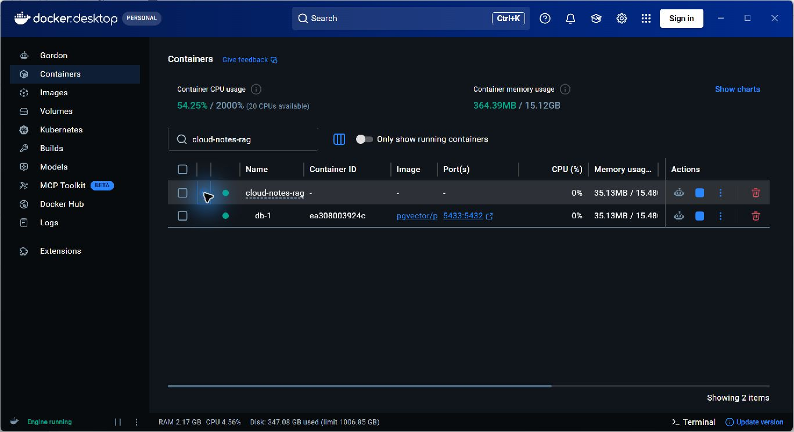
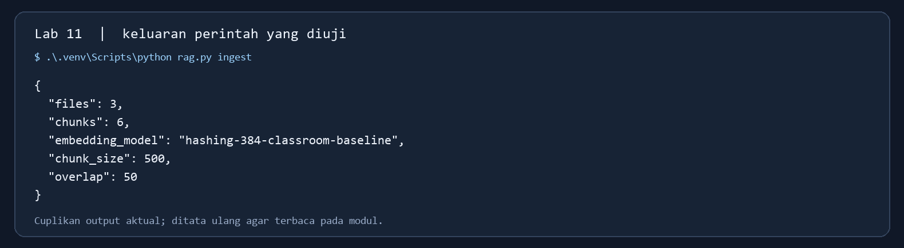
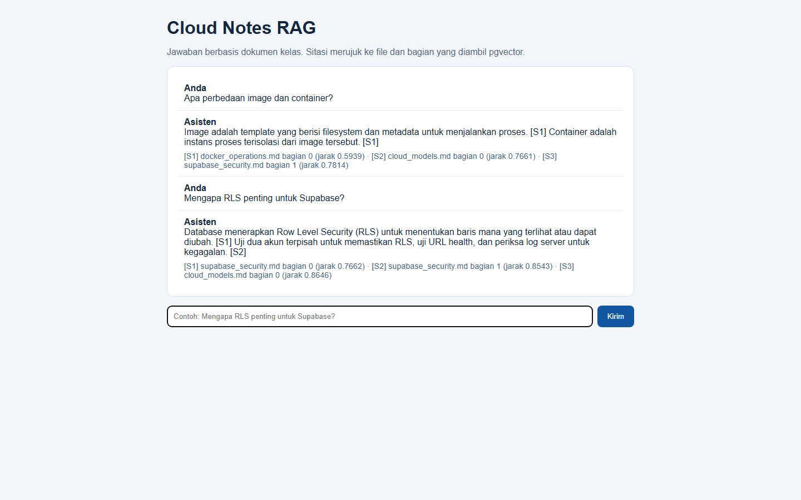
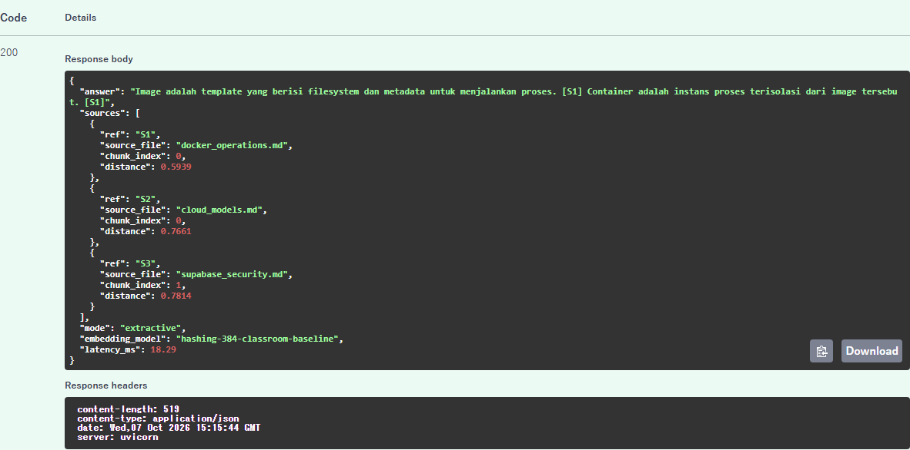

# Lab 11 — RAG lokal dengan pgvector dan sitasi

**Kebijakan kelas:** Lab ini latihan formatif, tanpa tugas, nilai, atau penyerahan terpisah. Satu proyek besar dikerjakan oleh kelompok **3 orang**, dengan presentasi checkpoint minggu 7 (UTS) dan hasil akhir minggu 14 (UAS). Simpan hasil lab hanya bila berguna sebagai referensi atau bukti proses proyek. Baca [brief proyek kelompok](PROYEK_KELOMPOK.md). Bobot resmi tetap mengikuti RPS/LMS.

**Subtopik RPS:** chunk 500/50, embedding, pgvector, retrieval top-K, jawaban bersumber, chat, dan evaluasi latensi. Jalur kelas memakai Docker Desktop, Python 3.10+, vector hash lokal, dan jawaban ekstraktif. Tidak perlu API key atau akun cloud.

Panduan ini memakai **Windows PowerShell**. Jalankan satu baris perintah setiap kali, lalu baca hasilnya sebelum lanjut. Internet diperlukan untuk clone dan pemasangan pertama. Server lokal tetap berjalan di terminalnya sampai dihentikan dengan `Ctrl+C`.

**Bukti latihan opsional:** screenshot yang tersedia menunjukkan contoh hasil pengujian sebelumnya. Angka waktu dan probabilitas pada komputer Anda dapat berbeda. Gambar terminal berlatar gelap adalah teks keluaran aktual yang ditata ulang agar terbaca, bukan screenshot terminal langsung. Simpan hasil Anda sendiri untuk referensi proyek bila berguna. Tidak ada laporan atau push terpisah yang wajib dikumpulkan.

## 1. Clone dan siapkan folder

Nyalakan Docker Desktop sampai Engine running. Buka PowerShell pada folder induk praktikum:

```powershell
git clone https://github.com/SeedFlora/meet11CloudService.git meet11CloudService-local
cd .\meet11CloudService-local
Get-Location
python --version
docker version
Copy-Item .\.env.example .\.env
```

Folder kerja berakhir dengan `meet11CloudService-local`. `docker version` menampilkan Client dan Server. `.env` menyediakan pengaturan DB dan password contoh untuk latihan lokal. Clone baru ini memisahkan praktik dari konfigurasi atau database percobaan lama. File `.env` diabaikan Git. Tidak perlu membuat file secret terpisah.

## 2. Jalankan database dan pasang paket

```powershell
docker compose up -d --wait
docker compose ps
python -m venv .venv
.\.venv\Scripts\python -m pip install -r requirements.txt
```

Compose menyalakan PostgreSQL dengan extension pgvector pada **127.0.0.1:5433**. Status DB harus **healthy** sebelum ingest. Named volume mempertahankan data saat container berhenti. Venv memisahkan paket Python lab tanpa mengubah execution policy.



*Baca gambar:* DB berjalan di Docker. API Python port 8011 berjalan pada terminal terpisah dan tidak muncul sebagai container.

## 3. Ingest dan uji retrieval di Terminal 1

```powershell
.\.venv\Scripts\python rag.py ingest
.\.venv\Scripts\python rag.py ask "Apa perbedaan image dan container?"
```

Ingest membaca `.md`/`.txt` di `docs/`, mengganti indeks secara transaksional, dan menampilkan **3 file / 6 chunk** untuk korpus bawaan. Mode hash membuat vector **384 dimensi**, ukuran chunk **500 token demo**, dan overlap **50**. Token demo memakai regex, sehingga berbeda dari token model LLM. Hash ini baseline leksikal dan tidak mengunduh model semantik.

Jawaban CLI mengandung `[S1]` dan sumber. Buka dokumen sumber lalu cocokkan kalimat jawabannya. Sitasi membantu penelusuran, tetapi belum membuktikan kebenaran.



*Baca gambar:* jumlah file/chunk, mode hash, ukuran, dan overlap. Gambar menata ulang keluaran run sebelumnya.

## 4. Jalankan API dan chat di Terminal 1

```powershell
.\.venv\Scripts\python -m uvicorn app:app --host 127.0.0.1 --port 8011
```

Biarkan terminal terbuka. Buka **http://127.0.0.1:8011**. Ajukan pertanyaan `Apa perbedaan image dan container?`, lalu `Mengapa RLS penting untuk Supabase?`. UI menyimpan percakapan untuk ditampilkan. Setiap pertanyaan menjalankan retrieval baru, jadi baseline ini tidak menyelesaikan rujukan seperti “jelaskan itu” dari riwayat chat.



*Baca gambar:* `[S1]`, `source_file`, `chunk_index`, dan jarak. Cosine distance lebih kecil berarti vector lebih dekat menurut representasi yang dipakai.

## 5. Periksa API dari Terminal 2

Buka PowerShell kedua pada folder repo yang sama. Terminal 1 tetap menjalankan Uvicorn.

```powershell
Invoke-RestMethod http://127.0.0.1:8011/health
Invoke-RestMethod http://127.0.0.1:8011/ready
```

`/health` memberi `status=ok` ketika proses API hidup. `/ready` memberi `status=ready`, `chunks=6`, dan mode hash setelah DB serta indeks siap. Readiness memberi 503 sebelum ingest atau saat DB tidak siap.

Buka **http://127.0.0.1:8011/docs**, perluas **POST /api/ask**, klik **Try it out**, isi JSON berikut, lalu **Execute**:

```json
{"question":"Apa perbedaan image dan container?","top_k":3}
```

Hasil yang diharapkan **HTTP 200**, jawaban, dan tiga sumber. Ganti body menjadi berikut lalu Execute lagi:

```json
{"question":"uji","top_k":0}
```

Hasil yang diharapkan **HTTP 422** karena `top_k` hanya menerima 1–10. Validasi ini tidak membutuhkan perubahan data.



*Baca gambar:* HTTP 200 serta struktur answer/sources. Uji top_k nol pada halaman yang sama untuk melihat penolakan 422.

## 6. Ukur latensi dan ubah dokumen

Di Terminal 2:

```powershell
.\.venv\Scripts\python benchmark.py --repeat 5
.\.venv\Scripts\python -B tests\challenge.py
```

Benchmark menjalankan tiga pertanyaan × lima pengulangan: **15 sampel**. Baca p50 median dan p95 nearest-rank. Angkanya bergantung laptop. Pemeriksa mengharapkan **10 PASS, 0 FAIL** saat DB, indeks hash, dan API siap.

Tambahkan satu file `.md` pendek berisi prosedur kelas yang aman di `docs/`. Jalankan lagi `.\.venv\Scripts\python rag.py ingest` di Terminal 2. Jumlah file/chunk bertambah sesuai isi file. Tanyakan isi prosedur itu dan periksa sumbernya. Ingest mengganti indeks dari dokumen yang tersedia saat perintah dijalankan.

## 7. Selesai dan diskusi

Hentikan Uvicorn di Terminal 1 dengan `Ctrl+C`. Di folder repo:

```powershell
docker compose down
```

Volume tetap menyimpan data latihan. Jelaskan pengaruh chunk/overlap, beda hash dan semantic embedding, serta alasan sumber terdekat belum tentu menjawab pertanyaan. Simpan screenshot dan ringkasan latensi untuk proyek bila berguna. `.env`, token, cache model, dan `benchmarks.jsonl` tidak boleh masuk Git.

Perluasan opsional ada di [README](README.md). Source proyek dapat disimpan mengikuti [panduan Git](PANDUAN_GIT.md).
